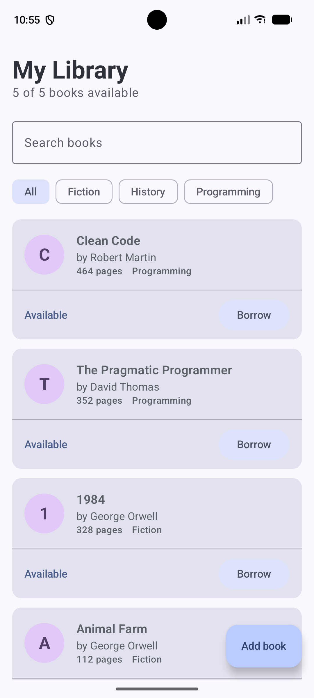
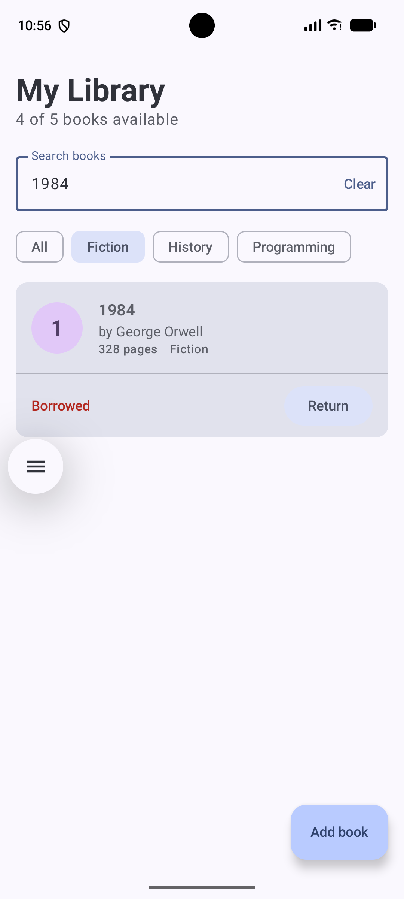
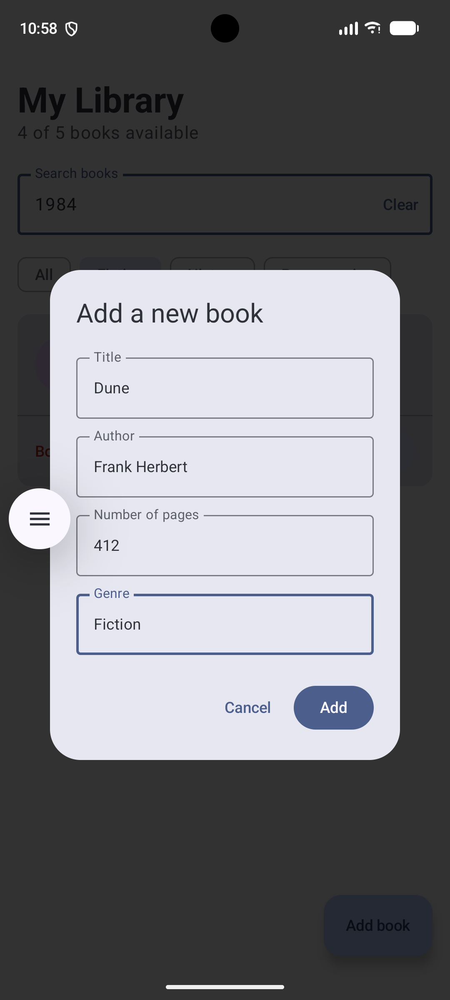

# Homework 02 - Library App

An Android library-management application developed using Kotlin, Jetpack Compose, Material 3, and ViewModel.

This project adapts the library models and application idea from Homework 01 into an interactive Android application.

## Features
- Browse books in a scrollable library catalog
- View each book's title, author, page count, genre, and availability
- Search books by title or author
- Filter books by genre
- Borrow and return books
- Add new books using a validated input form
- Display live availability and book counts
- Preserve application and form state during device rotation
- Support portrait and landscape orientations

## Technologies

- Kotlin
- Android SDK
- Jetpack Compose
- Material 3
- ViewModel
- StateFlow
- Gradle Kotlin DSL

## Architecture and State Management

The application separates UI presentation from application state and logic:

- `Book` is an immutable data model.
- `LibraryUiState` describes the state displayed by the screen.
- `LibraryViewModel` manages books, searching, filtering, borrowing, returning, and adding books.
- Compose components receive state and callbacks instead of containing application logic.

The project demonstrates three Compose state mechanisms:

- `remember` keeps temporary UI state during recomposition but does not survive Activity recreation.
- `rememberSaveable` preserves simple UI state, such as form input and dialog visibility, during Activity recreation.
- `ViewModel` preserves screen state and application logic during configuration changes such as device rotation.

## Reusable Composable Components

The application includes reusable components such as:

- `BookCard`
- `BookSearchField`
- `GenreFilterRow`
- `AddBookDialog`
- `LibraryHeader`

## Screenshots

### Main library screen



### Search, filter, and borrowed state



### Add-book dialog



## How to Run

1. Clone the repository:
```bash
git clone https://github.com/salikhP/mobile-programming-fall-2026.git
```

2. Open the `homework02` directory in Android Studio.
3. Wait for Gradle synchronization to finish.
4. Create or select an Android emulator with API 24 or newer, or connect a physical Android device.
5. Select the `app` run configuration.
6. Click **Run**.

## Command-Line Build

From the `homework02` directory:

```
./gradlew assembleDebug
```

The generated debug APK will be located under:

```
app/build/outputs/apk/debug/
```
